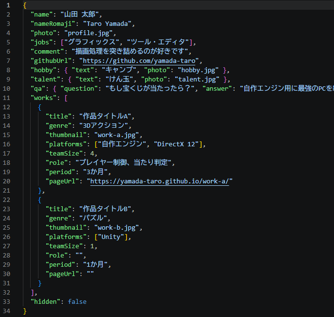

# JSON の書き方

`profile.json` の書き方です。完成するとこうなります（[完成見本 _example](https://github.com/miyosisouta/kawahara-28-portfolio/blob/main/members/_example/profile.json)）。

---

## 書き方の流れ

1. [記入用ひな形 _sample](https://github.com/miyosisouta/kawahara-28-portfolio/blob/main/members/_sample/profile.json) を開き、右上の「Copy raw file」で中身をコピーする
2. 自分の `profile.json` に貼り付ける
3. 下の説明を見ながら、`""` や `[]` の中を書いていく

**`"name"` などの左側（項目名）は書き換えないでください。** 右側の `""` の中だけを書きます。

---

## 自分の情報

### name（名前）
自分の名前を**漢字**で書きます。苗字と名前の間に**半角スペース**を入れると見やすくなります。
例）`"name": "山田 太郎",`

### nameKana（ふりがな）
名前の読みを**ひらがな**で書きます。苗字と名前の間は半角スペース。**メンバー一覧はこの順（あいうえお順）に並びます。**
例）`"nameKana": "やまだ たろう",`

### nameRomaji（ローマ字）
名前をローマ字で、**名前 → 苗字**の順に書きます。
例）`"nameRomaji": "Taro Yamada",`

### photo（顔写真）
顔写真の**ファイル名**を書きます。実際の写真の名前と**完全に同じ**にしてください。
例）`"photo": "profile.jpg",`（png なら `"profile.png"`）

### jobs（希望職種）
[10個の選択肢](../02_準備するもの.md#希望職種)から**最大3つ**、**第1希望から順に**書きます。同じものは2回書きません。
例）`"jobs": ["グラフィックス", "ツール・エディタ"],`

### comment（ひとことコメント）
自分を一言で表すコメントです。**「」は付けません**（サイトで自動で付きます）。
例）`"comment": "描画処理を突き詰めるのが好きです",`

### githubUrl（GitHub のページ）
自分の GitHub のページの URL です。
例）`"githubUrl": "https://github.com/yamada-taro",`

### hobby（趣味）・talent（特技）
`text` に内容、`photo` に写真のファイル名を書きます。
例）`"hobby": { "text": "キャンプ", "photo": "hobby.jpg" },`

### qa（Q&A）
自由に質問を1つ決めて、その答えを書きます。
例）`"qa": { "question": "もし宝くじが当たったら？", "answer": "最強のPCを組む" },`

---

## 作品の情報（works）

作品1つにつき `{ }` を1つ書きます。**2つ以上あるときは、`{ }` と `{ }` の間に `,` を入れて並べます**（完成見本を参考に）。

### title（作品名）・genre（ジャンル）
例）`"title": "作品タイトルA",` `"genre": "3Dアクション",`

### thumbnail（サムネイル）
作品のサムネイル画像の**ファイル名**です。
例）`"thumbnail": "work-a.jpg",`

### platforms（使ったエンジン・ライブラリ）
[お手本の表記](../02_準備するもの.md#作品の情報作品ごとに)にそろえて書きます。「自作エンジン」はサイトで目立つ表示になります。
例）`"platforms": ["自作エンジン", "DirectX 12"],`

### teamSize（制作人数）
**数字**で書きます。**`""` で囲みません。** 1人で作ったなら `1` です。
例）`"teamSize": 4,`

### role（担当）
担当した内容です。**1人制作なら空欄 `""`** にします（サイトに「個人制作」と出ます）。「担当：」は付けません。
例）`"role": "プレイヤー制御、当たり判定",`

### period（制作期間）
期間だけを書きます。「制作期間：」は付けません。
例）`"period": "3か月",`

### pageUrl（ポートフォリオサイトの URL）
作品のポートフォリオサイトの URL です。**まだなければ空欄 `""`** にします（**行は消さない**）。
例）`"pageUrl": "https://yamada-taro.github.io/work-a/"`

---

## 最後に

### hidden（表示する・しない）
通常は **`false`** のままにします。サイトに出したくないときだけ `true` にします。
例）`"hidden": false`

書き終わったら、VS Code で**赤い波線が1つもない**ことを確認してください。波線にマウスを乗せると、何が間違っているか教えてくれます。

[← 03_GitHubでの操作.md に戻る](../03_GitHubでの操作.md)
