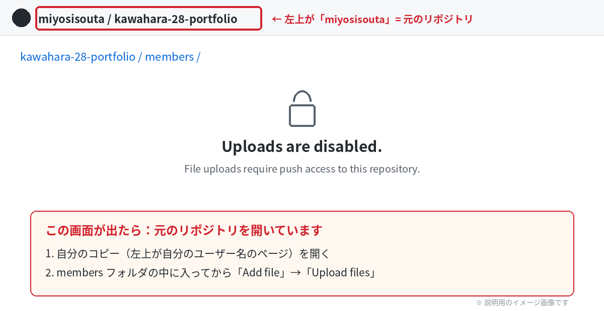

# よくあるミスと直し方

これまでに実際に起きたミスと、その直し方です。うまくいかないときは、まずここを見てください。

- [アップロード・プルリクのミス](#アップロードプルリクのミス)
- [サイトの表示のミス](#サイトの表示のミス)
- [作業の進め方のミス](#作業の進め方のミス)

---

## アップロード・プルリクのミス

### フォルダが `members` の外に入ってしまった

**多いと予想されるミスです。** フォークしたコピーのトップページのまま「Add file」を押すと、`src` や `public` と同じ場所に置かれてしまいます。

**直し方**
1. 出したプルリクを開いて、下の **「Close pull request」** で閉じる
2. 自分のコピーで、間違った場所のフォルダを開き、右上の **「…」→「Delete directory」** →「Commit changes」で消す
3. **`members` フォルダをクリックして中に入ってから**、[03_GitHubでの操作.md の手順4](../03_GitHubでの操作.md#手順4members-フォルダにアップロードする) をやり直す

### 「Uploads are disabled.（アップロードは無効になっています）」と出る



**原因**：左上が `miyosisouta` → 元のリポジトリを開いている → 元のリポジトリにはアップロードできない

**直し方**
1. [手順3](../03_GitHubでの操作.md#手順3自分用のコピーフォークを作る最初の1回だけ) で作った**自分のコピー**を開く（左上が**自分のユーザー名**になっているページ）
2. **`members` フォルダの中に入ってから**「Add file」→「Upload files」
3. まだコピーを作っていなければ、先に手順3でフォークする

### ファイルが `members` の直下にバラバラに置かれた

フォルダごとではなく、中のファイルだけをドラッグした、または「choose your files」から選んだときに起きます。

**直し方**：上の「members の外に入ってしまった」と同じように、プルリクを閉じて、置いたファイルを消してからやり直してください。今度は**フォルダごと**ドラッグします。

### フォルダの中にフォルダがもう1つできた

```
✕ members/yamada-taro/yamada-taro/profile.json
○ members/yamada-taro/profile.json
```

フォルダの中にさらにフォルダを入れてアップロードすると起きます。サイトは「members の中のフォルダの**すぐ下**の profile.json」しか読みません。

**直し方**：三好まで連絡してください。

---

## サイトの表示のミス

| こんなとき | 原因と直し方 |
|---|---|
| サイトに表示されない | まだマージされていない／ファイル名が `profile.json` になっていない／フォルダ名が `_` で始まっている／`hidden` が `true` になっている |
| マージされたのに、直した内容が反映されない | ブラウザが古いページを覚えています。**Ctrl + Shift + R**（Mac は Command + Shift + R）で再読み込みするか、数分待ってから開き直す |
| `undefined` と表示される | 項目名のスペルミス（例：`titel`）。`_sample` と同じ名前になっているか確認 |
| 写真が表示されない（グレーのまま） | JSON に書いたファイル名と、実際の写真のファイル名が違う（`.jpg` と `.png`、大文字・小文字の違いにも注意） → [写真について.md](写真について.md) |
| 並び順があいうえお順にならない | `nameKana` が空欄・カタカナ・漢字になっている。**ひらがな**で書く |
| 「ポートフォリオサイトへ」が出ない | `pageUrl` が空欄、またはスペルミス |
| 同じ希望職種のタグが何個も出る | `jobs` に同じ職種を2回以上書いている。1つずつにする |
| サイト全体が真っ白になった | 誰かの `profile.json` に書き間違いがあります → [JSONの書き方.md](JSONの書き方.md) |

---

## 作業の進め方のミス

| こんなとき | 原因と直し方 |
|---|---|
| ボタンの名前が手順書と違う | ブラウザの**自動翻訳**がオンになっています。オフにしてください |
| Fork（アプリ）でクローンしてしまった | クローンは不要です。ブラウザだけで [03_GitHubでの操作.md](../03_GitHubでの操作.md) の手順で投稿してください（クローンしたフォルダは消して大丈夫です） |
| 2回目の投稿で、他の人の分がなくなって見える | 自分のコピーが古いままです。「Sync fork」→「Update branch」で最新にしてから作業してください |
| プルリクに「This branch has conflicts」と出た | 自分のコピーが古いまま、元のリポジトリと違うところを変えたときに起きます。下の「コンフリクトが起きたとき」を見てください |

### コンフリクトが起きたとき

「Resolve conflicts」ボタンは**押さないでください**。次の手順で、自分のコピーを元のリポジトリと同じ状態に戻してからやり直します。

1. 出したプルリクを **「Close pull request」** で閉じる
2. 自分のコピーのトップページで **「Sync fork」** を押し、**「Discard 〇 commits」**（赤いボタン）を押す
   - 自分のコピーが、元のリポジトリとまったく同じ状態に戻ります（自分の投稿がマージ済みなら、それも入っています）
3. **`members` → 自分のフォルダ**の中に入ってから、直したいファイルをアップロードし直す
4. 「Contribute」→「Open pull request」でプルリクを出し直す

---

わからないときは三好まで。

[← 03_GitHubでの操作.md に戻る](../03_GitHubでの操作.md)
